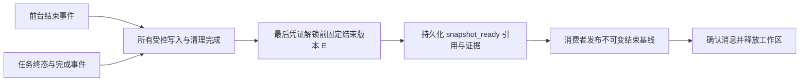

# 后台任务生命周期

更新：2026-10-15。

后台命令由宿主 BackgroundTasks 服务管理，服务实例归属 ToolRegistry。Shell 插件启动/停用时恢复接入或停止接入并取消、排空任务。内核仍只看到注入的工具契约，不管理线程、容器、数据库或重试。

## 生命周期约定

| 操作 | 行为 |
| --- | --- |
| Agent 本轮回复结束 | 后台任务继续；容器不供下一任务复用 |
| 取消任务 | 持久化 cancelling 请求，任务确认停止及清理后才记录 cancelled |
| 取消执行编号 | 同时覆盖前台请求和该执行产生的后台任务；回复结束后仍可取消后台任务 |
| 关闭会话 | 持久化关闭接入标记，取消该会话任务和请求，等待会话资源及共享 chat 凭证释放 |
| 停用 Shell 插件 | 当前宿主停止接入、取消其任务并排空；清理失败保留未确认资源 |
| API 应用正常退出 | lifespan 取消当前请求和后台任务，等待后台清理；正常进程退出也有 atexit 兜底 |
| CLI 新会话、切换工作区、退出 | 先关闭旧会话；清理未完成时不静默切换 |
| 浏览器标签关闭或 SSE 断开 | 不自动等同关闭会话；需要调用关闭入口 |
| 强制终止宿主 | 不假定任务已完成；失去 owner 锁的活动记录转 recovery_required，并隔离工作区 |

取消是请求，不代表命令回滚或清理已完成。如果命令已先完成，最终状态可以是 done。关闭等待超时或结果需要核对时，API 返回 409，CLI 明确提示，保留资源归属，不报告关闭成功。关闭的会话须显式 reopen，读取历史不触发重开。

## 归属与状态

每个任务固定持有 task_id、chat_id、execution_id、工作区、后端配置及启动时的父取消令牌；工作线程不再读取后续回合复用的 AgentState 来决定归属。任务拥有插件、会话、独立任务 owner 锁及保留的请求凭证。清理完成后释放这些凭证，所以后台写入期间其他请求不能修改同一工作区。

受控后台任务另持有一份宿主请求 guard：插件/会话资源清理完成、终态和完成消息提交、任务 owner 释放后，才归还 guard。这样清理失败或终态尚未落盘时，工作区不会先被其他请求取得。

任务元数据及有上限的输出保存在 data_dir/background_tasks.db（SQLite WAL），不再写入工作区 tasks/。查询和取消走独立控制入口，故不需要先获取正被后台任务持有的工作区锁。旧版工作区 tasks/ 文件保留，不自动迁入新系统：旧元数据缺少可信的会话/执行归属，不能据此启动或终止进程。

状态为 running → cancelling → cancelled，或 done、failed、timeout、error、recovery_required。cancelling 仍属于活动状态。查询最多返回 100 项，活动和待核对项优先于普通历史。输出保留 stdout 前 4000 字符、stderr 前 2000 字符；不是完整日志归档或流式日志服务。

不同进程使用同一 data_dir 时，可通过数据库请求取消。执行中的任务定期检查该请求。会话关闭标记同样共享；前台 SessionCancellation 与后台 TaskCancellation 检查它。关闭还尝试获取共享 chat 锁，覆盖别的宿主进程持有的请求以及尚未结束的阻塞模型传输；只发出取消而未排空时不能确认关闭。

## 使用入口

模型工具：shell_exec(background=true)、check_tasks(task_id 可选)、cancel_task(task_id)。它们均由 Shell 插件注入。后台任务完成前，后续 Agent 请求可能因为工作区忙而被拒绝；使用以下控制入口查询/取消，不通过新建模型回合轮询。

```powershell
research-agent tasks list --chat <会话ID>
research-agent tasks cancel --chat <会话ID> --task <任务ID>
```

交互 CLI 中可使用 /tasks、/cancel <任务ID>，不调用模型。

| HTTP 入口 | 用途 |
| --- | --- |
| GET /api/chats/{chat_id}/tasks | 查询会话任务 |
| POST /api/chats/{chat_id}/tasks/{task_id}/cancel | 取消该会话中的一个任务 |
| POST /api/executions/{execution_id}/cancel | 取消前台及关联后台任务 |
| POST /api/chats/{chat_id}/close | 关闭接入、取消并排空会话 |
| POST /api/chats/{chat_id}/reopen | 资源已排空后显式重开 |
| DELETE /api/chats/{chat_id} | 先成功关闭，再删除对话记录 |

任务取消和查询均限制到给定会话；不会按工作区扫描任意 JSON 再读取其指定的日志路径。工具描述和后台返回值会提示控制入口。

## 崩溃与边界

任务 owner 锁由操作系统持有，不靠 PID 存在与否猜测。查询或工作区接入发现失去 owner 的 running/cancelling 记录时，标记 recovery_required 并隔离目录；新会话也会按实际工作区检查旧会话任务。提案应用、工作区创建、合入、归档和恢复同样先检查。

Docker 容器按既有标签/槽位契约回收，见 [Docker 归属与验收](DOCKER_OWNERSHIP_AND_ACCEPTANCE.md)。本地 Shell 子进程在宿主强制退出后可能仍存活，不能仅凭 Python owner 消失就断言它已停止。未知结果不自动重放，任务管理没有新增绕过隔离的自动解封入口；后台任务的人工核对/审计解封工作流仍待完善。

等待人工审阅也会检查取消令牌，包含取消发生在审阅事件登记前的竞态，取消后移除 pending confirmation。单轮沙箱容量槽位在创建时固定 data_dir，后续清理不因环境变量变化误删另一数据目录的记录。

## 后台排空后的快照封存消息

checkpoint_events 是宿主的持久化 outbox 与投影消费者，使用同一 background_tasks.db 的 snapshot_runs / snapshot_events 表。前台结束写 foreground_finished；后台任务终态与 task_finished 在同一个 SQLite 事务提交。消息按本轮快照 SHA、execution、任务 ID 关联，唯一消息 ID 防止重复投递增加副作用；消费者以权威运行/任务状态判断条件，不依赖消息到达次序或数量。



最后一个 RequestLease 引用释放前执行一次宿主收尾回调，此时 OS 工作区锁仍持有。只有前台已安全结束、所有后台任务均非 running/cancelling/recovery_required，才捕获原始结束内容、暂存区和 Git 可达引用，再提交 snapshot_ready。结束版本的捕获必须在这个边界内完成，不能把“收到完成通知后重新读取当前工作区”当成可信的 Agent 结束版本。

消费者读取固定证据并用 baseline_once 发布，不读取当下文件生成新 E。正常路径在释放凭证前就地消费；消费失败或进程退出留下的 ready 消息，在 CLI/API 启动、请求接入、快照创建及工作区恢复检查时重放。消费前核对当前轮次、结束 Git 引用及原始快照元数据；旧轮消息过期处理，不覆盖新轮基线。发布后、确认前退出可重复消费同一份证据，原始 index 和文件摘要保持不变。延迟期间人工修改保留为当前 C，交给原有三方撤销审阅。

确认消息后清除其完整 payload，下一轮成功建基线并退休旧引用后删除所有旧轮投影和消息，包括未能封存的旧证据。新基线失败则保留旧记录；迟到的前台完成通知及收尾回调不能复活已退休轮次。可通过以下入口查看 waiting / suspended / capturing / ready / sealed / undo_unavailable / recovery_required / stale 与错误：

```text
research-agent checkpoint events --workspace <实际执行目录>
```

已确认停止的失败/取消可封存其最终文件状态；清理失败、未知副作用或前台未安全结束均不自动封存。Git 对象发布和 SQLite 提交不是一个事务：若仅在捕获期间、ready 消息持久化前崩溃，缺少可信 E，标为 undo_unavailable 并记录原因，不拿人工后改的当前文件补造 E；新轮安全接入并保存当前基线后可退休旧证据。执行结果未知仍是 recovery_required，后台任务及隔离保护不放宽。缺少请求凭证的旧版/直接调用后台任务也不获得自动封存保证；撤销可用性与执行是否安全分开判断。

网络挂起另用 suspended：本轮后续可能继续写入，暂不封存中间 E。相同执行安全恢复后重新登记凭证；工作区未变时沿用原 S，真正完成时才封存整轮 E。它不放宽后台任务的写入凭证、排空或隔离。详见[网络恢复](NETWORK_RECOVERY.md)。

## 验证

tests/test_background_tasks.py 覆盖：会话定向取消、回复后的执行取消、父令牌固定、单会话关闭与重开、插件排空、超时保留 owner、应用退出、请求取消、真实子进程崩溃、跨进程取消、跨宿主关闭标记、审批登记竞态，以及 CLI 控制。

tests/test_checkpoint_events.py 覆盖：前后台结束顺序互换、多个任务、失败/取消、未知结果和清理失败拒绝、延迟消费保留人工编辑、重复投递、发布后未确认重放、不可信 payload 拒绝、ready 前后真实进程硬退出，以及真实 run_agent 后台回复后继续下一轮。

真实 Docker 用例增加“回复结束后通过执行编号取消后台命令”，确认任务最终 cancelled、容器删除且工作区重新可用。七项真实验收已通过，证据见 artifacts/docker-real-acceptance.xml。

生命周期初次验收为 567 passed / 8 skipped。后台封存 outbox 与 Git 环境隔离补齐后，最新全量为 **665 passed / 8 skipped / 9 个第三方弃用警告，339.59 秒**，线程异常按错误处理；证据为 artifacts/background-snapshot-outbox-acceptance.xml。完成消息专项 **14 passed**，Git 维护专项 **19 passed**。

默认跳过七项真实 Docker 和一个原有 Windows 超时语义用例。本轮额外启用真实 Docker：**7 passed / 15.39 秒**，证据为 artifacts/background-snapshot-docker-acceptance.xml；覆盖后台回复后取消及资源回收。
