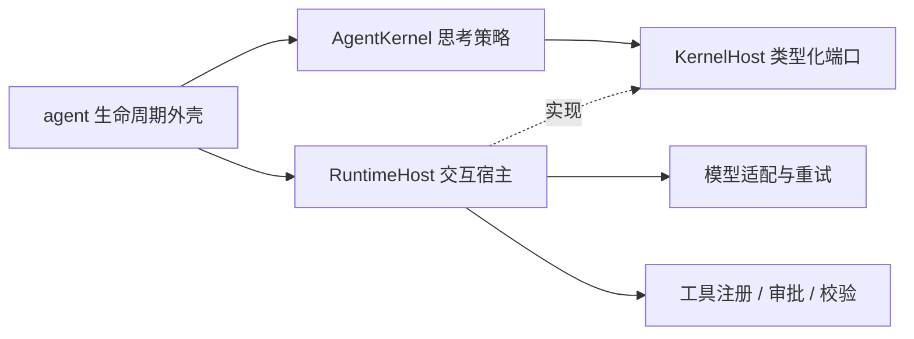

# 可替换内核与运行时宿主

更新：2026-10-15。以下为已落地实现。

## 职责与依赖方向

`agent.run_agent` 负责会话、工作区、插件装配、诊断、快照与回合后持久化；`runtime.RuntimeHost` 负责模型和工具交互；`kernel.AgentKernel` 决定如何推进思考、使用工具及结束回答。



kernel.py 仅依赖 Python 标准库，不导入 AgentState、工作区、配置、LLMProvider、context 或工具实现。替换内核无需改动交互宿主。

## 类型契约

- `AgentKernel.run(host: KernelHost, request: KernelRequest) -> KernelResult`：每回合返回结果，不修改应用状态。内核对象应将每回合可变状态保留在 run 内，避免请求间共享。
- `KernelRequest`：用户输入与正整数 max_rounds。
- `KernelResult`：回答、执行轮数、TerminationReason（completed / round_limit / failure_limit）。宿主适配层将它们写回原 AgentState，外壳继续持久化。
- `ToolCall`：调用 id、工具名和参数；`ModelResponse`：文本和工具调用元组；`ToolObservation`：成功与否、结果数据、是否被审批阻止。
- `KernelHost`：prepare / select / execute / after_tool / answer / emit / set_round。协议定义交互能力，不限定策略实现。
- `RuntimeContext`：保留兼容入口；registry 改用 ToolRegistryPort，审批、成功钩子与模型原语具有明确 Callable 签名。消息和工具载荷仍是 dict，类型化尚未深入 JSON 内容层。

数据类为 frozen，内部 dict 仍可变；它们不应被当作深度不可变对象。

## 默认策略与宿主行为

FunctionCallingKernel 构建工作消息，循环选择工具，按顺序执行并回灌结果。无工具调用时请求宿主生成回答；达到轮数或累计 5 次失败时生成降级回答并返回对应结束原因。审批阻止不计失败预算。循环守卫附加结果提示，不强制终止；重复调用与失败检测现在分别更新，不再因短路表达式漏记。

RuntimeHost 管理上下文构建、能力描述、模型 schema、传输重试、审批、参数校验、dispatch 和工具事件。execute 的审批/分发异常转换为失败观察，供策略处理；after_tool、prepare 和 answer 的异常仍向外传播，由调用方负责请求失败处理。没有额外声明一个未实现的统一错误状态。

宿主保留原始工具错误载荷（包括 stdout/stderr），替代旧循环中截断并改写错误文本的行为。流式回答仍由宿主生成，模型选择返回的 content 不直接作为最终回答。

`FunctionCallingRuntime(kernel=None)` 为旧接口适配器，默认装配 FunctionCallingKernel；原 AgentRuntime 和 RuntimeContext 导入路径继续可用。`MeteredRuntime` 观察宿主交互，退出时恢复包装过的回调，避免复用上下文时重复包装。

## 替换方式

```python
from research_agent.kernel import AgentKernel, KernelHost, KernelRequest, KernelResult

class DirectKernel(AgentKernel):
    id = "direct"

    def run(self, host: KernelHost, request: KernelRequest) -> KernelResult:
        response = host.answer(host.prepare())
        return KernelResult(response)

# 同一套工具、治理、诊断和持久化继续由外壳与宿主负责
state = run_agent(user_input, llm, state, kernel=DirectKernel())
```

当前提供 Python 显式注入入口与进程默认内核工厂，没有新增 CLI 策略选择或磁盘策略注册机制。新策略使用工具时应通过 execute，再将观察结果纳入自己的消息；成功后调用 after_tool，使外壳校验参与结果回灌。

## 已知边界

- 宿主模型选择的传输重试与内核回合失败预算为不同层；默认初次加 5 次传输重试，生产流式路径初次加 3 次。模型适配在 agent/runtime 仍有重复，留待统一。
- 默认内核保存 next/select/tools/answer 阶段，支持步骤恢复；流中断重发答复前发送 reply_reset，不提供供应商 token 级续传。取消和上下文预算由宿主承担，尚无整个任务的墙钟/费用硬预算。
- 参数检查目前由宿主调用历史静态表，尚未改为全面 schema 校验。
- 旧 AgentRuntime 是兼容接口；新策略应实现 AgentKernel，避免继续接触整个 RuntimeContext。
- 内核与宿主同步执行；计划工具内部并发不等于内核并行工具调度。

## 验证

test_kernel.py 验证独立宿主运行默认策略、轮数与失败终止原因，以及替代策略通过生产 run_agent 入口生成事件并持久化对话。既有 runtime、loop_guard、harness 和 telemetry 测试用于验证兼容装配与治理。

## 责任划分与重试

| 行为 | 负责方 |
| --- | --- |
| 下一步做什么、是否规划/反思、失败后换工具或换参数 | Kernel |
| 网络请求、响应解析、暂时故障的退避重发 | RuntimeHost |
| 工具审批、参数检查、执行、事件与成功后校验 | RuntimeHost |
| 推理失败预算、重复调用检测、何时结束 | Kernel |
| 会话、工作区、插件装配、快照、回合后存储 | agent 外壳 |

判断重试归属的标准：保持同一个意图重发交互请求，由宿主处理；改变下一步行动来恢复任务，由内核处理。

模型连接失败或限流，由宿主执行有界重试，耗尽后以控制信号穿透内核并保存 waiting_network；宿主可有限次恢复原步骤，不增加该步 round。工具参数错误、执行失败或结果不足，由内核决定换参数、换工具、重新规划或结束。审批拒绝是治理结果，不能通过自动重试绕过。工具副作用执行结果不确定时，不应盲目重发；可重试操作必须具备幂等保证。

宿主传输仅重试明确的暂时故障，鉴权/参数及未知错误通过 ModelRequestRejected 中止任务。暂时故障耗尽不再计为思考失败并循环选工具；默认 kernel 仍保留普通策略/工具失败的累计限制。流式输出已经发布后，当前调用不静默重播；执行恢复只重发答复阶段并显式替换旧前缀。详见[网络恢复](NETWORK_RECOVERY.md)和[传输与计量](PATH_RETRY_METERING.md)。

## 新循环与静默注入

当前策略是具有 ReAct 风格的 function-calling 行动/观察循环，没有显式 thought 文本协议。新循环应实现新的 AgentKernel 子类，在 run 内维护自己的阶段和局部状态，通过 KernelHost 与外界交互，返回 KernelResult。例如 plan-and-execute 可以依次规划、调度步骤、观察结果、重新规划、生成回答；无需改变工作区与会话管理。

静默注入指装配层选择策略，用户的请求格式与操作流程不变，不通过用户提示词或 monkey patch 偷换策略。已支持每回合显式注入：

```python
result = run_agent(message, llm, state,
                   workspace_dir=workspace, chat_id=chat_id,
                   kernel=PlanAndExecuteKernel())
```

CLI/API/chat 已共用默认内核选择。新增循环应继承 AgentKernel；工厂不需要继承，只负责构造与装配。应用启动时安装实例，后续请求复用；显式 kernel 优先。

现有端口仍有 ReAct 偏向：select 隐含工具选择，answer 附加固定总结提示词并流式输出。新策略可用 select.content 做内部规划，但无法显式关闭工具、指定阶段模型或控制流式可见性。严格的 plan/reflect 或多模型策略应进一步引入通用模型请求端口，明确消息、工具选择、阶段、模型角色和输出可见性，由内核指定意图、宿主执行与计量。

新策略使用工具须走 execute；成功后调用 after_tool 让校验参与回灌。验收需要覆盖两种内核处理相同请求、治理不能绕过、内部规划不误发 reply、结果正常存储和不同会话不共享可变状态。

## 默认内核工厂（已实现）

```python
from research_agent.kernel_factory import set_default_kernel_factory

# 在应用启动阶段设置；CLI/API/chat 后续请求无需修改参数
previous = set_default_kernel_factory(PlanAndExecuteKernel)
# 带构造参数也可使用 lambda: PlanAndExecuteKernel(...)
# 需要恢复时：set_default_kernel_factory(previous)
```

显式 kernel 优先，否则 get_kernel 返回已安装实例。进程初始创建一个 FunctionCallingKernel；set_default_kernel_factory 在配置时调用工厂一次，成功后原子替换实例。后续回合不再调用工厂。构造失败保留原实例，正在运行的回合继续持有原实例；配置仅作用于当前进程，不持久化。create_kernel 保留为兼容名称，行为也是获取已有实例。

内核实例保存稳定配置；消息、步骤、失败计数和守卫状态保留在 run 的局部变量中。自定义内核必须支持并发调用，不能把每次请求的可变状态存到实例字段。宿主与 RuntimeContext 仍按请求创建，避免事件和会话状态互相污染。

## 与目标拆分的差距

目标是循环控制在内核，交互执行与重试在外核，具体能力的定义和使用说明由工具层注入。当前已做到：内核不依赖具体工具、注册表或模型供应商；RuntimeHost.prepare 注入注册表生成的能力描述，select 注入工具 schema，execute 承担执行与治理。

尚未完全做到：默认 Kernel 仍含通用重复调用提示、累计失败控制和模型失败后的再次 select；这些是当前策略恢复逻辑，不是传输重试，但如果要求所有恢复机制均由外核提供，还需将其提取成宿主策略。默认 Kernel 也仍编码 OpenAI 风格消息格式。工具使用指引仍有部分留在 context 的基础提示词里，不能声称所有能力说明已完全归属工具层。现有 select/answer 对新循环也仍有限制。

新增具体工具不应修改内核；其名称、参数、用途及必要使用指引应由工具 schema/插件描述提供，宿主注入，模型据此做选择。循环只负责推进和处理观察结果。下一步应优先迁移 context 中具体能力指引到所属插件，并将交互恢复与消息协议进一步收敛到外核。

基础状态、配置和模型适配的当前边界见 [FOUNDATION.md](FOUNDATION.md)。模型工具/流式传输已集中到 model_adapter.py，旧函数保留为兼容转发。
